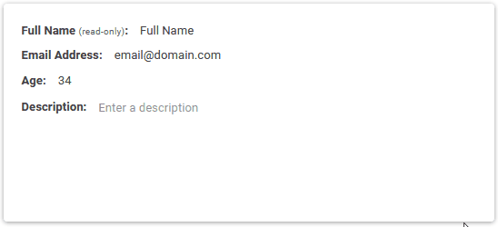

<h1 align="center">React Edit Text</h1>

<p align="center">
    <a href="https://sonarcloud.io/dashboard?id=bymi15_react-edit-text">
        
    </a>
    <a href="https://github.com/bymi15/react-edit-text/actions/workflows/publish.yml">
        
    </a>
    <a href="https://www.npmjs.com/package/react-edit-text">
        
    </a>
    <a href="https://www.npmjs.com/package/react-edit-text">
        
    </a>
</p>

<p align="center">This is an easy-to-use <b>editable text component</b> for <a href="https://react.dev/">React</a>. Simply click on the textbox to edit!</p>

<p align="center">Made with <span role="img" aria-label="love">❤️</span> by <a href="https://github.com/bymi15">Brian Min</a></p>

<p align="center">
	
</p>

## Demo

Please visit https://brianmin.com/react-edit-text/ for a live demo and various examples.

## Install

```bash
npm install react-edit-text
```

TypeScript types are included. If you previously installed `@types/react-edit-text`, you can remove it.

## Usage

Make sure to import the <b>CSS stylesheet</b> before using the component.

```jsx
import { EditText, EditTextarea } from 'react-edit-text';
import 'react-edit-text/dist/index.css';

export default function Example() {
  return (
    <div>
      <EditText showEditButton />
      <EditTextarea />
    </div>
  );
}
```

### Controlled components

Pass `value` together with `onChange`:

```jsx
const [title, setTitle] = useState('Hello');

<EditText
  name='title'
  value={title}
  onChange={(e) => setTitle(e.target.value)}
  onSave={({ name, value, previousValue }) => save(name, value)}
/>;
```

Pressing <kbd>Escape</kbd> cancels the edit. For a controlled component this
calls `onChange` with the value from before the edit started, so your state is
restored automatically.

### Keyboard and accessibility

- The text is a focusable button: <kbd>Tab</kbd> to it and press <kbd>Enter</kbd> or <kbd>Space</kbd> to edit.
- <kbd>Enter</kbd> saves (`EditText` only; in `EditTextarea` it inserts a new line), <kbd>Escape</kbd> cancels, and blurring the input saves.
- After saving or cancelling with the keyboard, focus returns to the text (or the edit button).
- Name the input with a `<label htmlFor={id}>` and the `id` prop, or with `inputProps={{ 'aria-label': '…' }}`.
- Pressing <kbd>Enter</kbd> to confirm IME composition (e.g. Japanese, Chinese or Korean input) does not save.

## Props

### Shared props

| Prop              | Type     | Default  | Description                                                                                                                                          |
| ----------------- | -------- | -------- | ---------------------------------------------------------------------------------------------------------------------------------------------------- |
| id                | string   |          | HTML id attribute, set on both the display and the input element                                                                                     |
| name              | string   |          | HTML name attribute of the input element                                                                                                             |
| className         | string   |          | HTML class attribute of the display element                                                                                                          |
| inputClassName    | string   |          | HTML class attribute of the input element                                                                                                            |
| value             | string   |          | Value of a controlled component                                                                                                                      |
| defaultValue      | string   |          | Initial value of an uncontrolled component                                                                                                           |
| placeholder       | string   | `''`     | Shown when the value is empty, in both the display and the input                                                                                     |
| formatDisplayText | function | (x) => x | Formats the value shown in the display element. May return a string or any React node                                                                |
| onSave            | function |          | Called with `{ name, value, previousValue }` when the input is saved and the value changed                                                           |
| onChange          | function |          | Called with the input's change event whenever its value changes (including when Escape reverts it)                                                   |
| onEditMode        | function |          | Called when the component enters edit mode                                                                                                           |
| onBlur            | function |          | Called when the component leaves edit mode (saved or cancelled)                                                                                      |
| style             | object   |          | CSS style of both the display and the input element                                                                                                  |
| readOnly          | bool     | false    | Only show the display element; edit mode can't be entered                                                                                            |
| editOnDoubleClick | bool     | false    | Enter edit mode on double click instead of single click. Keyboard and screen reader activation still work; double-tap is unreliable on touch devices |
| inputProps        | object   |          | Extra attributes for the input element, e.g. `maxLength`, `autoComplete`, `required`, `aria-*`                                                       |
| ref               | ref      |          | Forwarded to the input element (`null` while not in edit mode)                                                                                       |

### EditText props

| Prop              | Type   | Default     | Description                                                                           |
| ----------------- | ------ | ----------- | ------------------------------------------------------------------------------------- |
| type              | string | `'text'`    | HTML input type                                                                       |
| inline            | bool   | false       | Display the component inline                                                          |
| showEditButton    | bool   | false       | Show an edit button that enters edit mode, instead of making the text clickable       |
| editButtonContent | node   | pencil icon | Content of the edit button. This can be any valid element                             |
| editButtonProps   | object | `{}`        | Props passed to the edit button. Its default accessible name is "Edit" (`aria-label`) |

### EditTextarea props

| Prop | Type             | Default | Description                                                    |
| ---- | ---------------- | ------- | -------------------------------------------------------------- |
| rows | number \| 'auto' | 3       | Number of visible rows, or `'auto'` to fit the display element |

## Migrating from v5 to v6

- **TypeScript types are built in.** Uninstall `@types/react-edit-text`. The exported type names (`EditTextProps`, `EditTextareaProps`, `SharedProps`, `onSaveProps`, `inputTextType`) are unchanged.
- **`readonly` is deprecated** in favour of `readOnly`. `readonly` still works for now.
- **The `aria-label="display component"` / `"input component"` attributes were removed.** They overrode the real content for screen readers. If your tests queried them, use `getByRole('button')` / `getByRole('textbox')` instead.
- **The display element is now `role="button"` with `tabIndex={0}`** (unless `readOnly` or `showEditButton` is set), so it can be reached with the keyboard.
- **`onChange` now fires while typing in uncontrolled components too**, and the event passed on Escape is a real change event (previously it was a partial copy without `target.name`). It is only called on Escape when the value actually changed.
- **`prop-types` is no longer used.** Runtime prop warnings were removed; use the TypeScript types instead.
- **The UMD build was removed.** The package ships ES module and CommonJS builds, with an `exports` map. Import the stylesheet from `react-edit-text/dist/index.css` (or `react-edit-text/style.css`).
- **CSS:** the `!important` declarations were removed so your own styles override more easily, inputs use `box-sizing: border-box`, the edit button inherits its colour and has a transparent background, the placeholder colour is darker for contrast, and the multi-line display preserves whitespace (`white-space: pre-wrap`).
- React 16.8 or later is required (hooks). React 18 and 19 are tested in CI.

## Contributing

Contributions are very much appreciated and welcome.
Please refer to the [contributing guidelines](https://github.com/bymi15/react-edit-text/blob/main/CONTRIBUTING.md) for more details.

## License

MIT © [Brian Min](https://github.com/bymi15)
